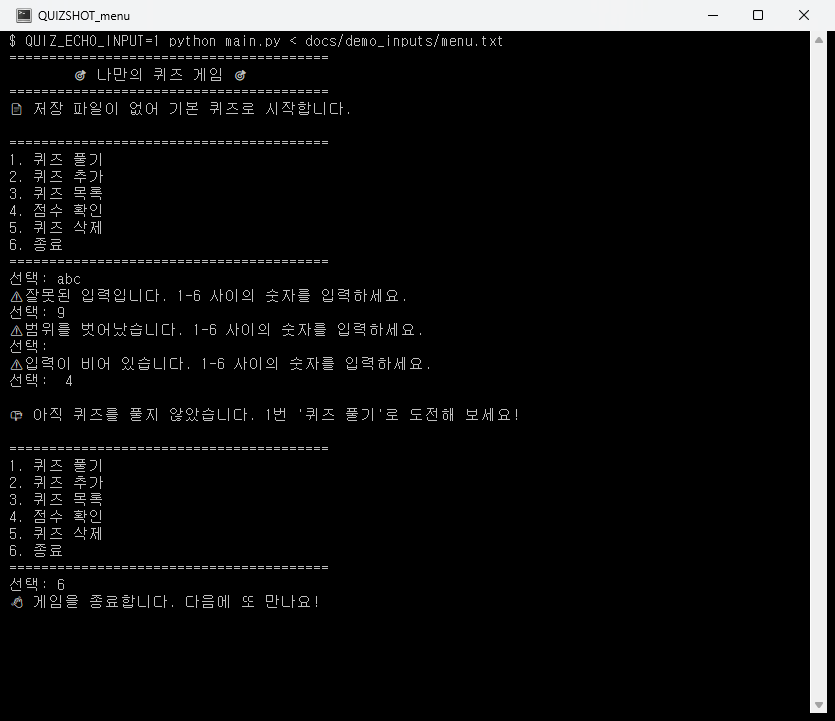
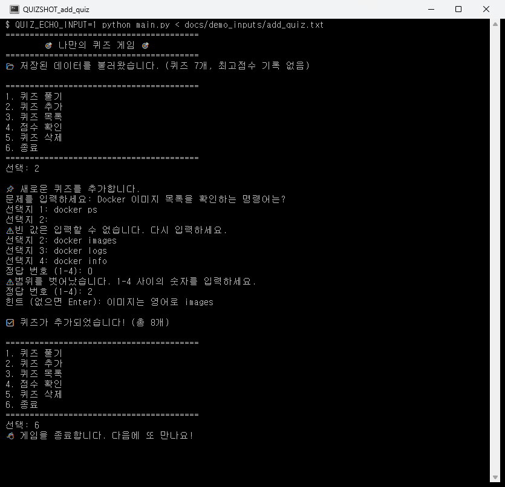
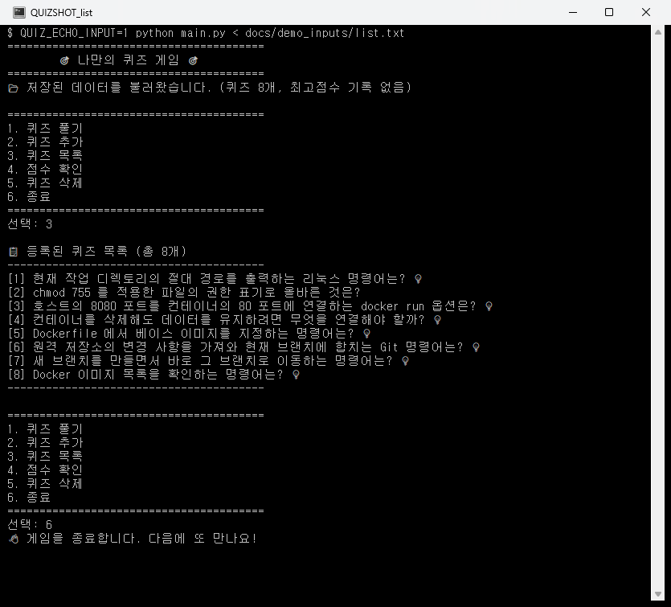
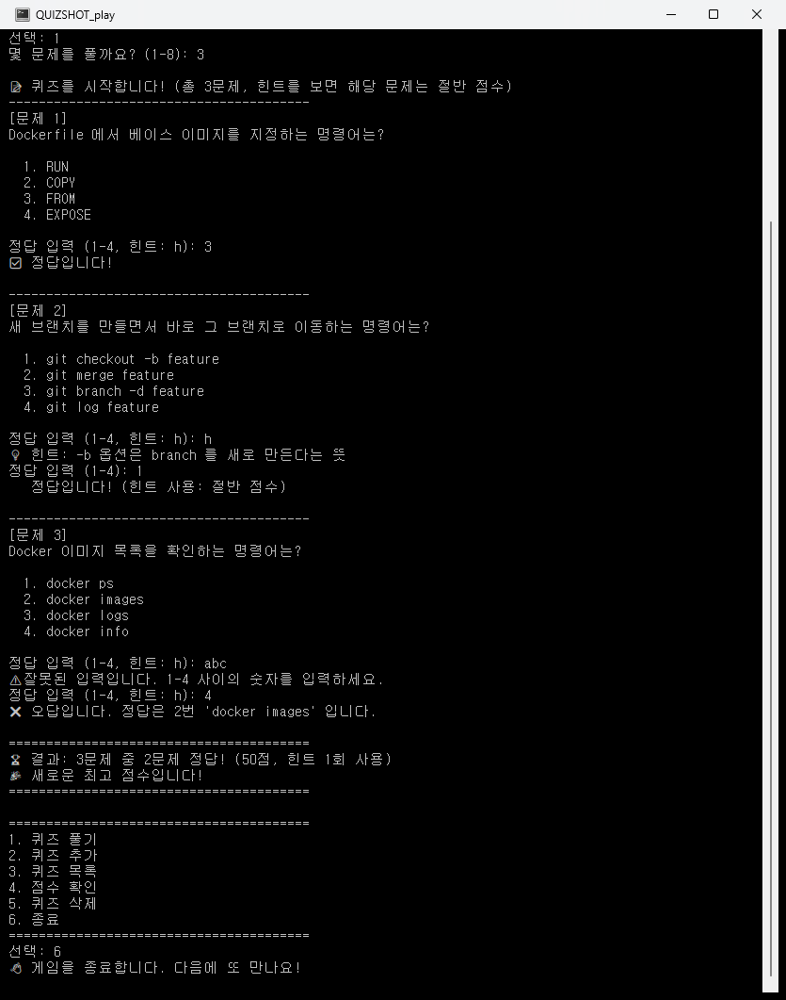
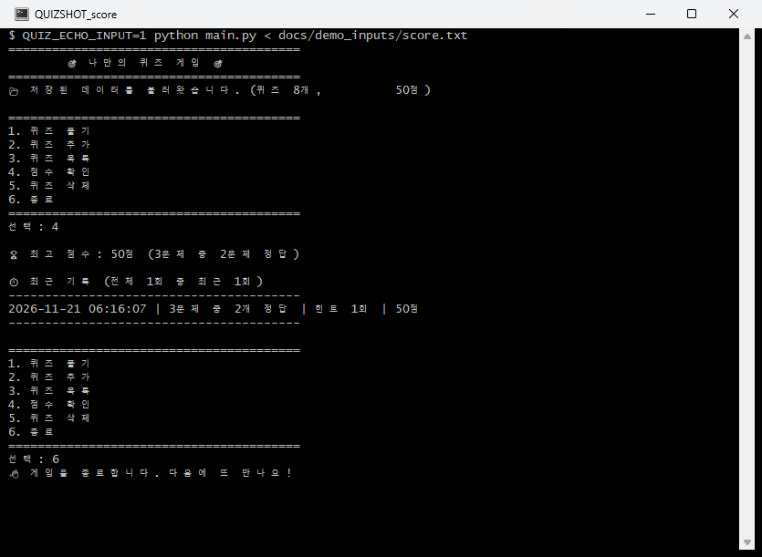
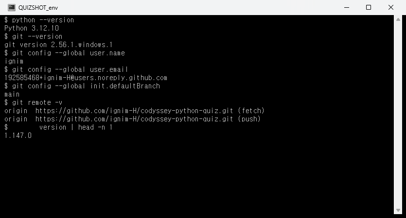
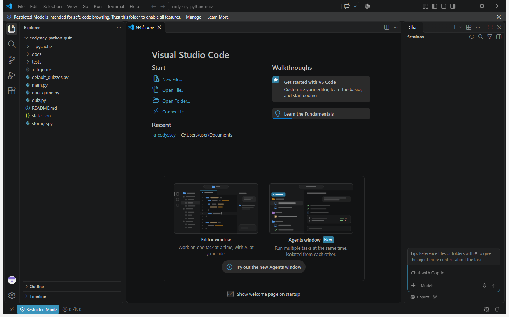
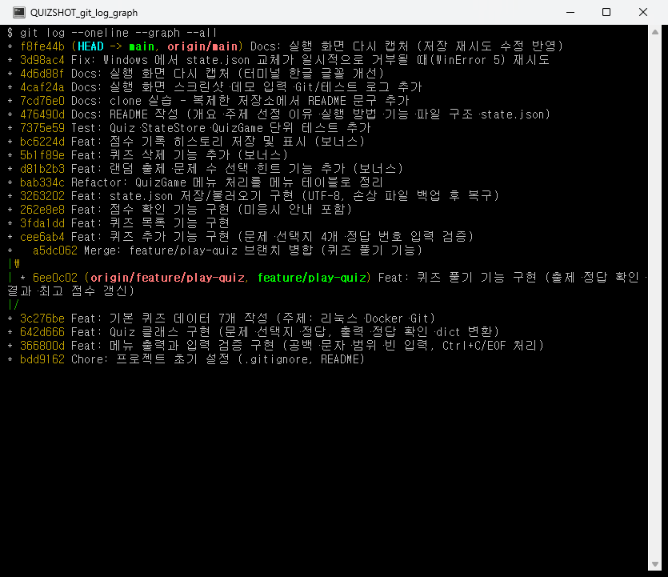

# 🎯 나만의 퀴즈 게임 (Python 콘솔)

터미널에서 동작하는 4지선다 퀴즈 게임입니다. 메뉴에서 번호를 골라 **퀴즈 풀기 · 추가 · 목록 · 점수 확인 · 삭제**를 할 수 있고, 퀴즈와 점수는 `state.json` 에 저장되어 프로그램을 껐다 켜도 유지됩니다.

## 목차
1. [프로젝트 개요](#1-프로젝트-개요)
2. [퀴즈 주제와 선정 이유](#2-퀴즈-주제와-선정-이유)
3. [실행 방법](#3-실행-방법)
4. [기능 목록](#4-기능-목록)
5. [파일 구조](#5-파일-구조)
6. [데이터 파일 설명 (state.json)](#6-데이터-파일-설명-statejson)
7. [입력 · 예외 처리](#7-입력--예외-처리)
8. [실행 화면](#8-실행-화면)
9. [Git 작업 기록](#9-git-작업-기록)
10. [테스트](#10-테스트)
11. [개념 정리](#11-개념-정리)

---

## 1. 프로젝트 개요

| 항목 | 내용 |
|---|---|
| 목표 | Python 기본 문법 + 클래스로 퀴즈 게임을 처음부터 끝까지 구현하고, Git 으로 기능 단위 이력을 관리 |
| 언어 / 환경 | Python 3.10 이상, **외부 라이브러리 없음** (표준 라이브러리만 사용) |
| 클래스 | `Quiz`(문제 1개), `QuizGame`(게임 진행), `StateStore`(파일 저장) — 역할별로 분리 |
| 데이터 영속성 | 프로젝트 루트의 `state.json` (UTF-8) 에 퀴즈 목록 · 최고 점수 · 게임 기록 저장 |

## 2. 퀴즈 주제와 선정 이유

**주제: 개발 도구 기초 (리눅스 · Docker · Git)**

바로 앞 미션(개발 워크스테이션 구축)에서 터미널 명령어, 파일 권한, Docker 포트 매핑/볼륨, Git 브랜치를 직접 다뤘습니다. 손으로 익힌 내용을 문제로 다시 풀어 보면 개념을 정확히 기억하는지 확인할 수 있어서, 복습용 퀴즈로 주제를 정했습니다. 기본 퀴즈 7개가 들어 있고 각 문제에 힌트가 있습니다.

## 3. 실행 방법

```bash
git clone https://github.com/ignim-H/codyssey-python-quiz.git
cd codyssey-python-quiz
python main.py          # Windows 에서 python 이 없다고 나오면: py main.py
```

- 처음 실행하면 `state.json` 이 없으므로 기본 퀴즈로 시작하고 파일을 새로 만듭니다.
- 종료는 메뉴의 `6. 종료` 또는 `Ctrl+C` (저장 후 안전하게 종료).
- 선택 환경 변수 (시연/테스트용)
  - `QUIZ_RANDOM_SEED=값` : 출제 순서를 매번 같게 고정
  - `QUIZ_ECHO_INPUT=1` : 파일로 입력을 넣을 때(`python main.py < 입력.txt`) 입력값도 화면에 표시

## 4. 기능 목록

| 메뉴 | 기능 | 세부 내용 |
|---|---|---|
| 1 | 퀴즈 풀기 | 풀 문제 수 선택 → **무작위 순서**로 출제 → 정답/오답 즉시 안내 → 결과(정답 수, 점수) 표시 → 최고 점수 비교·갱신 후 저장. 퀴즈가 없으면 안내 |
| | 힌트 | 힌트가 있는 문제는 정답 입력 시 `h` 로 힌트 보기. 힌트를 본 문제는 맞혀도 **절반 점수** |
| 2 | 퀴즈 추가 | 문제, 선택지 4개, 정답 번호(1-4), 힌트(선택) 입력 → 즉시 파일 저장 |
| 3 | 퀴즈 목록 | 등록된 문제 목록 (💡 = 힌트 있음). 퀴즈가 없으면 안내 |
| 4 | 점수 확인 | 최고 점수와 최근 게임 기록 5개(날짜/시간, 문제 수, 정답 수, 힌트 사용, 점수). 아직 안 풀었으면 안내 |
| 5 | 퀴즈 삭제 | 번호로 삭제(0 = 취소) → 파일 반영 |
| 6 | 종료 | 저장 후 종료 |

> 필수 기능: 1~4, 6 / 보너스: 랜덤 출제, 문제 수 선택, 힌트, 퀴즈 삭제, 점수 기록 히스토리

## 5. 파일 구조

```
codyssey-python-quiz/
├── main.py               # 실행 파일: UTF-8 콘솔 설정 후 QuizGame 실행
├── quiz.py               # Quiz 클래스 - 문제/선택지/정답/힌트, 출력, 정답 확인, dict 변환·검증
├── quiz_game.py          # QuizGame 클래스 - 메뉴, 입력 처리, 풀기/추가/목록/점수/삭제, 저장 연동
├── storage.py            # StateStore 클래스 - state.json 읽기/쓰기, 손상 파일 백업
├── default_quizzes.py    # 기본 퀴즈 7개 (Quiz 인스턴스로 생성)
├── tests/
│   └── test_quiz_game.py # unittest 단위 테스트
├── docs/
│   ├── screenshots/      # 실행 화면 · 개발 환경 · git log 캡처
│   ├── demo_inputs/      # 실행 화면 캡처에 사용한 입력 파일
│   ├── git_workflow.log  # 실제로 실행한 Git 명령과 출력 기록
│   └── test_result.log   # 단위 테스트 실행 결과
├── .gitignore            # state.json, __pycache__ 등 제외
└── README.md
```

| 클래스 | 속성 | 주요 메서드 |
|---|---|---|
| `Quiz` | `question`, `choices`, `answer`, `hint` | `display()`, `is_correct()`, `has_hint()`, `to_dict()`, `from_dict()` |
| `QuizGame` | `quizzes`, `best_score`, `best_record`, `history`, `store`, `menu` | `run()`, `show_menu()`, `select_menu()`, `read_line()`, `read_number()`, `read_text()`, `play_quiz()`, `add_quiz()`, `list_quizzes()`, `show_score()`, `delete_quiz()`, `load()`, `save()` |
| `StateStore` | `path` | `load()`, `save()`, `backup_corrupted()` |

## 6. 데이터 파일 설명 (state.json)

- **경로**: 프로젝트 루트의 `state.json` (`main.py` 와 같은 폴더. 어느 위치에서 실행해도 같은 파일 사용)
- **역할**: 추가한 퀴즈, 최고 점수, 게임 기록을 저장해 재실행 후에도 유지
- **인코딩**: UTF-8 (`ensure_ascii=False` 로 한글을 그대로 저장)
- **저장 시점**: 퀴즈 추가/삭제 직후, 게임 종료 직후, 프로그램 종료 시, Ctrl+C 로 중단 시
- **안전한 저장**: `state.json.tmp` 에 먼저 쓴 뒤 교체 → 저장 중 오류가 나도 기존 파일이 깨지지 않음
- **Git 제외**: 실행할 때마다 바뀌는 사용자 데이터라 `.gitignore` 에 포함

```json
{
  "quizzes": [
    {
      "question": "Dockerfile 에서 베이스 이미지를 지정하는 명령어는?",
      "choices": ["RUN", "COPY", "FROM", "EXPOSE"],
      "answer": 3,
      "hint": "Dockerfile 의 첫 줄에 주로 온다"
    }
  ],
  "best_score": 50,
  "best_record": {"correct": 2, "total": 3},
  "history": [
    {"played_at": "2026-11-21 06:10:00", "total": 3, "correct": 2, "hints_used": 1, "score": 50}
  ]
}
```

| 키 | 타입 | 설명 |
|---|---|---|
| `quizzes` | list | 퀴즈 목록. `question`(str), `choices`(str 4개), `answer`(1~4 정수), `hint`(str, 선택) |
| `best_score` | int 또는 null | 최고 점수(0~100). 아직 안 풀었으면 `null` |
| `best_record` | object 또는 null | 최고 점수를 낸 판의 `correct`(정답 수), `total`(문제 수) |
| `history` | list | 모든 게임 기록: `played_at`, `total`, `correct`, `hints_used`, `score` |

**점수 계산**: `점수 = round(획득 점수 / 문제 수 × 100)`, 정답 1점 · 힌트 사용 후 정답 0.5점 · 오답 0점

## 7. 입력 · 예외 처리

| 상황 | 처리 |
|---|---|
| 앞뒤 공백 (` 4 `) | `strip()` 후 처리 |
| 숫자가 아님 (`abc`) | "잘못된 입력입니다" 안내 → 다시 입력 |
| 범위 밖 (메뉴 `9`, 정답 `0`) | "범위를 벗어났습니다" 안내 → 다시 입력 |
| 빈 입력 (Enter) | "입력이 비어 있습니다" 안내 → 다시 입력 |
| 문제/선택지 빈 값 | "빈 값은 입력할 수 없습니다" 안내 → 다시 입력 |
| `Ctrl+C`, 입력 종료(EOF) | `QuitGame` 으로 바꿔 안내 → **저장 후 안전 종료** (traceback 없음) |
| `state.json` 없음 | 기본 퀴즈로 시작하고 파일 생성 |
| JSON 손상 / 구조 오류 | 안내 후 원본을 `state.json.bak` 으로 보관하고 기본 퀴즈로 복구 |
| 읽기/쓰기 오류 (`OSError`) | 안내 메시지 출력, 프로그램은 계속 실행 |

## 8. 실행 화면

캡처는 실제 프로그램을 [`docs/demo_inputs/`](docs/demo_inputs) 의 입력 파일로 실행한 화면입니다. 각 창 첫 줄에 실행 명령이 보입니다.

| 메뉴 · 잘못된 입력 처리 | 퀴즈 추가 |
|---|---|
|  |  |

| 퀴즈 목록 | 퀴즈 풀기 (힌트 · 오답 · 결과) |
|---|---|
|  |  |

| 점수 확인 (재실행 후 데이터 유지) | 개발 환경 (Python · Git 설정) |
|---|---|
|  |  |

**VSCode**



## 9. Git 작업 기록

- 기능 단위 커밋: 초기 설정 → 메뉴 → Quiz 클래스 → 기본 데이터 → 퀴즈 풀기 → 추가 → 목록 → 점수 → 저장/불러오기 → 구조 정리 → 보너스 기능 → 테스트 → README
- 브랜치: `feature/play-quiz` 에서 퀴즈 풀기 기능을 개발한 뒤 `main` 으로 `--no-ff` 병합
- clone / pull 실습: 저장소를 별도 폴더(`codyssey-python-quiz-clone`)에 clone → README 한 줄 추가 후 commit/push → 원래 폴더에서 `pull` 로 반영 확인
- 사용한 명령: `init`, `add`, `commit`, `push`, `pull`, `checkout`, `clone`, `merge`, `remote`
- 실제 실행 기록: [docs/git_workflow.log](docs/git_workflow.log)



## 10. 테스트

```bash
python -m unittest discover -s tests -v
```

Quiz 검증, 파일 저장/손상 복구, 잘못된 입력 재시도, Ctrl+C 안전 종료, 최고 점수 유지 등 11개 테스트 → 결과: [docs/test_result.log](docs/test_result.log)

## 11. 개념 정리

**변수** — 값에 이름을 붙여 저장해 두는 공간. 같은 값을 여러 곳에서 쓰거나 값이 바뀌어도 이름으로 다룰 수 있다. 예: `self.best_score`

**자료형** — `int`(정수, 정답 번호·점수), `str`(문자열, 문제), `bool`(참/거짓, 정답 여부), `list`(순서 있는 여러 값, 선택지·퀴즈 목록), `dict`(키-값 쌍, JSON 저장 형태)

**if / elif / else** — 조건에 따라 다른 코드 실행. 예: 정답이면 점수 추가, 아니면 정답 안내

**for vs while** — `for` 는 정해진 횟수/목록을 돌 때(문제 목록 출제), `while` 은 조건이 만족될 때까지 반복할 때(올바른 숫자를 받을 때까지 재입력, 메뉴 반복)

**함수 · 매개변수 · 반환값** — `read_number(prompt, low, high)` 는 범위를 매개변수로 받아 검증된 정수를 반환 → 메뉴·정답·문제 수 입력에 재사용

**클래스 · 객체** — 데이터(속성)와 동작(메서드)을 한 덩어리로 묶는 설계도. `Quiz` 하나가 문제 하나를 책임지고, `QuizGame` 이 전체 흐름을, `StateStore` 가 파일을 책임져 역할이 분리된다

**`__init__` 과 `self`** — `__init__` 은 객체가 만들어질 때 속성을 초기화하는 메서드, `self` 는 "지금 이 객체 자신"을 가리켜 객체마다 다른 값을 가질 수 있게 한다

**파일 입출력** — `open(경로, 모드, encoding="utf-8")` 으로 열고 `with` 블록이 끝나면 자동으로 닫힌다. 읽기 `"r"`, 쓰기 `"w"`

**JSON** — 사람이 읽을 수 있는 텍스트 형식으로 dict/list 를 그대로 저장할 수 있어, 프로그램 데이터를 파일로 보관하고 다시 불러오기 쉽다 (`json.dump` / `json.load`)

**try / except** — 오류가 날 수 있는 코드를 감싸 프로그램이 멈추지 않게 처리. 예: `int("abc")` 의 `ValueError`, 손상된 JSON 의 `JSONDecodeError`, `Ctrl+C` 의 `KeyboardInterrupt`

**Git vs GitHub** — Git 은 내 컴퓨터에서 변경 이력을 관리하는 도구, GitHub 는 그 저장소를 원격에 올려 공유·협업하는 서비스

| 명령 | 하는 일 |
|---|---|
| `git init` | 현재 폴더를 Git 저장소로 만든다 |
| `git add` | 커밋할 변경 사항을 스테이징 영역에 올린다 |
| `git commit` | 스테이징된 변경을 하나의 이력(스냅샷)으로 저장한다 |
| `git push` | 로컬 커밋을 원격 저장소(GitHub)에 올린다 |
| `git pull` | 원격의 새 커밋을 가져와 현재 브랜치에 합친다 |
| `git checkout` | 브랜치를 이동한다 (`-b` 는 새로 만들면서 이동) |
| `git clone` | 원격 저장소 전체를 새 폴더로 복제한다 |
| `git merge` | 다른 브랜치의 작업을 현재 브랜치에 합친다 |
